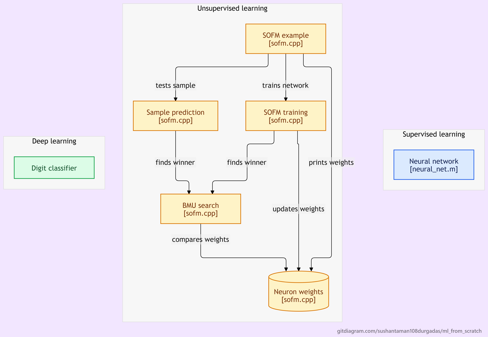

<div align="center">

# 🧠 Machine Learning From Scratch

### *Exploring Machine Learning the Old-School Way — Building the Foundations One Algorithm at a Time*

**C++ • GNU Octave • Neural Networks • SOFM • Convolutional Neural Networks • Deep Learning**

[](https://github.com/Sushantaman108Durgadas/ml_from_scratch/stargazers)
[](https://github.com/Sushantaman108Durgadas/ml_from_scratch/network)
[](https://github.com/Sushantaman108Durgadas/ml_from_scratch/issues)

**A hands-on machine learning repository focused on understanding how learning algorithms work internally by implementing their core operations from scratch.**

</div>

---

# 📖 Overview

This repository documents my journey into Machine Learning through a more fundamental, implementation-oriented approach.

Instead of depending entirely on high-level machine learning libraries, the goal is to understand the mathematics and computational steps behind learning algorithms by building their components directly.

The repository currently explores three major areas:

- **Supervised Learning:** Training a feedforward neural network to learn the XOR function.
- **Unsupervised Learning:** Implementing a Self-Organizing Feature Map (SOFM) to discover patterns and map input samples to neurons.
- **Deep Learning:** Building a Convolutional Neural Network (CNN) to classify a small, hand-coded dataset of digits from 0 to 9.

The project is a complementary exploration to my [TrenTorch repository](https://github.com/Sushantaman108Durgadas/TrenTorch), with an emphasis on understanding machine learning fundamentals through lower-level implementations.

---

# 📌 System Architecture

The repository is organized around three learning paradigms, each demonstrating a different approach to learning patterns from data.



### Core Architectural Flow

1. **Supervised Learning — Neural Network:** A configurable feedforward neural network accepts input features, processes them through user-defined hidden layers and learns the XOR input-output mapping using backpropagation.
2. **Unsupervised Learning — SOFM:** A Self-Organizing Feature Map trains without labelled targets. It identifies the Best Matching Unit (BMU) for each input and updates the weights of the winning neuron and its neighbourhood.
3. **Deep Learning — CNN:** A convolutional neural network processes 9×9 binary digit matrices through a learnable convolution kernel, ReLU activation, flattening, a fully connected layer and softmax classification.

---

# 🧠 Learning Implementations

## 1. Supervised Learning — Feedforward Neural Network

<text></text>

**File:** `Supervised_learning/neural_net.m`

A feedforward neural network implemented in GNU Octave to learn the XOR Boolean function.

### Key Concepts

- Configurable number of input features.
- User-defined number of hidden layers and neurons per layer.
- Random weight initialization and bias initialization.
- Forward propagation through hidden and output layers.
- Activation functions: ReLU, Sigmoid and Tanh.
- Mean Squared Error (MSE) loss calculation.
- Backpropagation for computing gradients.
- Gradient descent for updating weights and biases.

### Network Configuration

The saved execution example uses:

| Parameter | Value |
| :--- | :--- |
| Input neurons | 2 |
| Hidden layers | 2 |
| Hidden layer neurons | 3, 4 |
| Output neurons | 1 |
| Learning rate | 0.1 |
| Epochs | 10,000 |
| Training problem | XOR |

### Sample Output

The network learns the XOR mapping:

| Input | Expected Output | Predicted Output |
| :--- | :---: | :---: |
| 0, 0 | 0 | 0.0536 |
| 0, 1 | 1 | 0.9871 |
| 1, 0 | 1 | 0.9899 |
| 1, 1 | 0 | 0.0094 |

The saved run reduces the loss to approximately **0.003229** after 10,000 epochs.

---

## 2. Unsupervised Learning — Self-Organizing Feature Map (SOFM)

**File:** `Unsupervised_learning/sofm.cpp`

A C++ implementation of a Self-Organizing Feature Map, an unsupervised neural network that learns to organize input patterns through competitive learning.

### Key Concepts

- Layer-based representation of input and output neurons.
- Random initialization of neuron weights.
- Best Matching Unit (BMU) selection using Euclidean distance.
- Neighbourhood-based weight updates.
- Gaussian neighbourhood influence.
- Decaying learning rate and neighbourhood radius.
- Training and prediction using the learned neuron weights.

### Working Principle

1. **Input Sample:** A feature vector is passed to the network.
2. **BMU Search:** The Euclidean distance between the input and each output neuron's weight vector is calculated.
3. **Winner Selection:** The neuron with the minimum distance becomes the Best Matching Unit.
4. **Neighbourhood Update:** The BMU and nearby neurons update their weights towards the input sample.
5. **Learning Decay:** The learning rate and neighbourhood radius decrease as training progresses.
6. **Prediction:** A new sample is mapped to its closest output neuron.

### Training Configuration

| Parameter | Value |
| :--- | :--- |
| Input neurons | 2 |
| Output neurons | 4 |
| Training samples | 4 |
| Epochs | 200 |
| Initial learning rate | 0.1 |

The example uses four two-dimensional input samples:

```cpp
{
    {0.1, 0.2},
    {0.9, 0.8},
    {0.2, 0.1},
    {0.8, 0.9}
}
```

### Sample Prediction

After training, the test sample:

```cpp
{0.5, 0.8}
```

is mapped to **Output Neuron (BMU) #2** in the saved execution.

---

## 3. Deep Learning — Convolutional Neural Network (CNN)

**File:** `deep_learning/digit_classification_conv_net.m`

A CNN implemented in GNU Octave to demonstrate the internal operations of a convolutional neural network without relying on a deep learning framework.

The implementation uses a hand-coded binary dataset containing digit patterns from 0 to 9, represented as 9×9 matrices.

### CNN Architecture


The network follows this pipeline:

1. **Input Layer:** Receives a 9×9 binary digit matrix.
2. **Convolutional Layer:** Applies a learnable 3×3 kernel using stride 1 and valid padding, producing a 7×7 feature map.
3. **ReLU Activation:** Applies `max(0, x)` to introduce non-linearity.
4. **Flatten Layer:** Reshapes the 7×7 feature map into a 49-element vector.
5. **Fully Connected Layer:** Maps the 49 features to 10 output classes.
6. **Softmax Layer:** Converts class logits into normalized probabilities.
7. **Prediction:** Selects the digit corresponding to the highest probability.

### Training Configuration

| Parameter | Value |
| :--- | :--- |
| Input image dimensions | 9×9 |
| Number of digit classes | 10 |
| Convolution kernel | 3×3 |
| Feature map dimensions | 7×7 |
| Flattened features | 49 |
| Dense layer | 49 → 10 |
| Learning rate | 0.05 |
| Epochs | 1,000 |
| Loss function | Categorical Cross-Entropy |
| Optimizer | Gradient Descent |

### Key Concepts

- Hand-coded binary dataset generation.
- Convolution and feature-map extraction.
- ReLU activation and its derivative.
- Flattening spatial features.
- Fully connected neural network layer.
- Softmax probability calculation.
- Categorical cross-entropy loss.
- Backpropagation through dense and convolutional operations.
- Gradient descent weight updates.

### Sample Results

The saved execution reports the following results on the ten hand-coded digit templates:

| Metric | Result |
| :--- | :---: |
| Training epochs | 1,000 |
| Final average loss | 0.0002 |
| Correct template predictions | 10/10 |
| Template-set accuracy | 100% |

**Note:** This result demonstrates learning and classification on the small, predefined dataset included in the program. It should not be interpreted as 100% accuracy on a general handwritten-digit dataset.

---

# 📊 Project Comparison

| Learning Paradigm | Implementation | Language | Demonstration |
| :--- | :--- | :--- | :--- |
| Supervised Learning | Feedforward Neural Network | GNU Octave | XOR classification |
| Unsupervised Learning | Self-Organizing Feature Map | C++ | BMU-based pattern mapping |
| Deep Learning | Convolutional Neural Network | GNU Octave | 0–9 digit template classification |

---

# 📁 Repository Directory Structure

```text
ml_from_scratch/
│
├── deep_learning/
│   ├── digit_classification_conv_net.m
│   ├── digit_classification_conv_net_architecture.txt
│   └── digit_classification_conv_net_op.txt
│
├── Supervised_learning/
│   ├── neural_net.m
│   └── neural_net_op.txt
│
├── Unsupervised_learning/
│   ├── sofm.cpp
│   └── sofm_op.txt
│
├── assets/
│   └── images/
│       └── diagram.png
│
└── README.md
```

---

# ⚙️ Technologies Used

### Programming Languages

- C++
- GNU Octave / MATLAB-compatible syntax

### Machine Learning Concepts

- Feedforward Neural Networks
- Supervised Learning
- Unsupervised Learning
- Self-Organizing Feature Maps
- Convolutional Neural Networks
- Backpropagation
- Gradient Descent
- Activation Functions
- Softmax Classification

### Core Mathematical Operations

- Matrix multiplication
- Euclidean distance
- Convolution
- Partial derivatives and gradients
- Loss calculation
- Weight and bias optimization

---

# 🚀 Getting Started

## 1. Clone the Repository

```bash
git clone https://github.com/Sushantaman108Durgadas/ml_from_scratch.git
cd ml_from_scratch
```

## 2. Run the Supervised Learning Implementation

Install [GNU Octave](https://octave.org/) and execute:

```bash
cd Supervised_learning
octave neural_net.m
```

The program prompts you to enter the number of input features, hidden layers and neurons in each hidden layer.

For the saved example, use:

- Input features: `2`
- Hidden layers: `2`
- Neurons in hidden layer 1: `3`
- Neurons in hidden layer 2: `4`

## 3. Run the Unsupervised Learning Implementation

Compile the C++ program using a C++ compiler:

```bash
cd Unsupervised_learning
g++ sofm.cpp -o sofm -std=c++11
```

Run the executable:

```bash
./sofm
```

On Windows:

```bash
sofm.exe
```

The program trains the SOFM, prints the learned neuron weights and tests a sample using BMU prediction.

## 4. Run the Deep Learning Implementation

Using GNU Octave:

```bash
cd deep_learning
octave digit_classification_conv_net.m
```

The program initializes the hand-coded digit dataset, trains the CNN and evaluates predictions for digits 0–9.

---

# 🚧 Roadmap

- [ ] Extend the supervised neural network with additional datasets and classification problems.
- [ ] Experiment with different activation functions and training hyperparameters.
- [ ] Explore larger SOFM architectures and multidimensional input datasets.
- [ ] Extend the CNN with additional convolutional filters and feature maps.
- [ ] Experiment with more diverse digit datasets beyond hand-coded templates.
- [ ] Explore additional machine learning algorithms through from-scratch implementations.

---

# 🎯 Project Objective

The primary objective of this repository is to strengthen the understanding of machine learning by implementing the underlying mechanisms rather than treating models as black boxes.

Through these implementations, the repository explores how neural networks initialize weights, process inputs, calculate errors, propagate gradients and gradually learn patterns.

It is an ongoing learning journey, with each implementation serving as a foundation for exploring more advanced machine learning and deep learning concepts.

---

# 👤 Author

**Suyash Subodh Shirsat**

- GitHub: [@Sushantaman108Durgadas](https://github.com/Sushantaman108Durgadas)

---

# 🤝 Contributing

Suggestions, improvements and contributions are welcome!

1. Fork the repository.
2. Create a new branch.
3. Implement your changes.
4. Commit your changes.
5. Push the branch.
6. Open a Pull Request.

---

<div align="center">

### ⭐ If you find this repository interesting, consider giving it a star!

*“The best way to understand an algorithm is not just to use it, but to build it.”*

</div>
